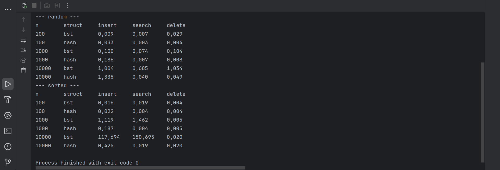

## BST vs Hash Table

## What I did

• I wrote a Binary Search Tree (bst.java) and a Hash Table with chaining (hashtable.java).
• I wrote a benchmark (Main.java) that tests insert, search and delete.
• I tested with 100, 1000 and 10000 elements.
• I tested two cases: random keys and sorted keys.
• Time is in milliseconds. Full output is in results.txt.

To run it, open Main.java and press Run.

## Complexity

BST

• Insert: best case O(log n) when the tree is balanced, worst case O(n) when the tree looks like a line.

• Search: best case O(log n), worst case O(n).

• Delete: best case O(log n), worst case O(n).

Hash Table

• Insert: best case O(1), worst case O(n) when all keys go to one cell.

• Search: best case O(1), worst case O(n).

• Delete: best case O(1), worst case O(n).

In my hash table the array grows when it is 75% full, so the lists stay short and the average is O(1).

## Results

## Comparison

 With random keys the hash table is much faster in search and delete. For 10000 elements search is 0,685 ms in BST and 0,040 ms in hash table.
 Insert is almost the same. The hash table is a bit slower sometimes because it needs to resize the array.
 With sorted keys the BST becomes very slow. For 10000 elements insert takes 117 ms in BST and only 0,4 ms in hash table.
 When n grows from 1000 to 10000, BST insert on sorted keys grows about 100 times. This is O(n squared) for all inserts, because each insert goes through the whole line. The hash table time stays small.
 Delete in BST on sorted keys is fast only because I delete keys in the same order, so each time the smallest key is at the root. It does not mean BST is good at delete.

## Why performance is different in practice

 The BST depends on the order of the data. Random keys give a tree with height about log n. Sorted keys give a line, so every operation is O(n).
 The hash table does not care about the order. A good hash function spreads keys evenly, so lists are short and operations are close to O(1).
 The hash table can be slow if there are many collisions or a bad hash function.
 Resize costs O(n), but it happens rarely, so on average it is fine.
 BST is still useful when we need keys in order (for example print all keys from smallest to biggest). A hash table can not do this.

## Conclusion

For simple insert, search and delete the hash table is faster and more stable. The BST is good on random data, but it can become very slow on sorted data. A balanced tree (like AVL or Red Black) would fix this problem.